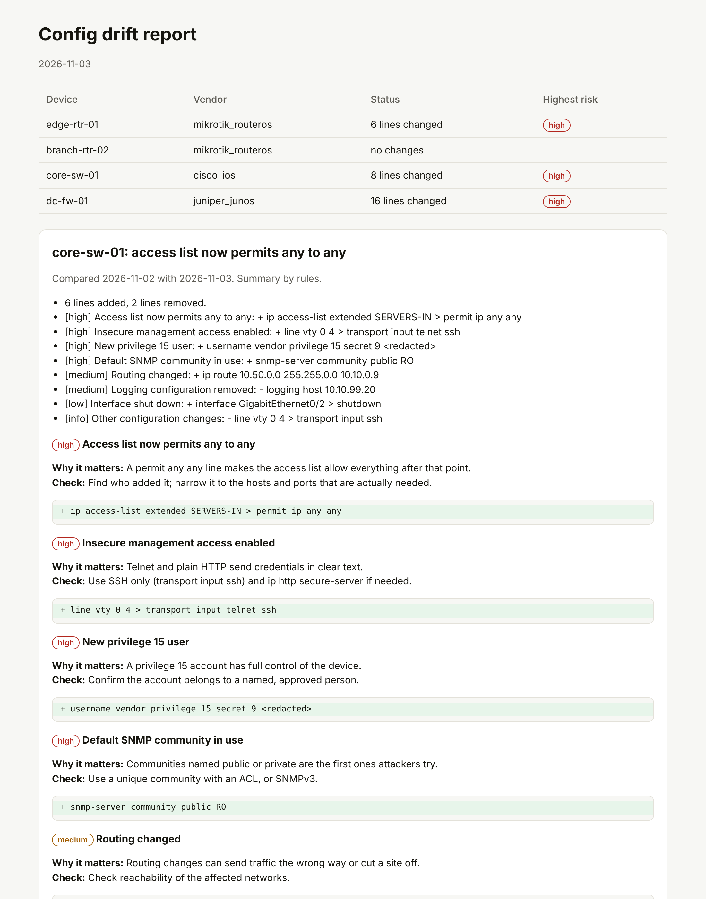

# Network config drift detector

[](https://github.com/arafathossein/network-config-drift-detector/actions/workflows/tests.yml)

**Know what changed on your routers, switches and firewalls since yesterday.** Every day this tool backs up the configuration of each MikroTik, Cisco IOS and Juniper Junos device, compares it with the previous backup, explains the changes in plain English and flags the risky ones: a new any-to-any rule, a port forward, telnet switched on, a new admin account, a changed default route, logging removed.

It only reads. It never changes a device, and every report has passwords, keys and SNMP communities replaced with `<redacted>`.

Built by [AFYRA Technologies](https://afyra-iota.vercel.app).



*Rendered from the bundled sample configs with `config-drift demo`. All devices and addresses are fictional.*

## Why

Many network outages and security holes begin with an ordinary change. A rule added in a hurry, a route removed by mistake, a "temporary" port forward that is still open a year later. Nobody notices until users complain or an auditor asks.

Raw diffs don't fix that. Few managers read `transport input telnet ssh` and see a problem, and a device that prints a new timestamp on every export looks changed every day. This tool removes the noise, groups what's left by risk, and says what to check.

## What it does

| Step | Detail |
| --- | --- |
| **Back up** | Reads the running config over SSH with a read-only command (`/export terse`, `show running-config`, `show configuration \| display set`), or from files another tool already saved. One file per device per day, kept 90 days by default, readable only by the service user. |
| **Compare** | Ignores lines that change on every export (timestamps, byte counts, clock period). Keeps context: a Cisco line is shown with the block it sits in, so `permit ip any any` reads as `ip access-list extended SERVERS-IN > permit ip any any`. Reordered firewall rules are reported, because order changes what they do. |
| **Flag** | 40 rules across the three vendors, each with a severity, why it matters and what to check. Each changed line is counted once, under its most specific rule. |
| **Explain** | A built-in summary always works. Point it at any OpenAI-compatible model, including a local one, for a more natural summary; the model only sees redacted lines and its answer is redacted again. |
| **Report** | Markdown, HTML and JSON per run, plus an optional Slack message listing only the devices that need attention. |

### What gets flagged

| Severity | Examples |
| --- | --- |
| High | Any-to-any access list or policy, router input accepted from anywhere, port forward or destination NAT added, telnet / FTP / plain HTTP management enabled, new full-rights user, default route changed, SNMP community `public` or `private` |
| Medium | Other firewall, NAT, routing, user, SNMP or AAA changes; logging targets removed |
| Low | Interface shut down or disabled |
| Info | Anything else that changed |

## Quick start

### Try it without any devices

```bash
python -m venv .venv && source .venv/bin/activate     # Windows: .venv\Scripts\activate
pip install -e ".[dev]"

config-drift demo            # two days of sample configs, report in reports/
pytest                       # 78 tests
```

### Compare two files you already have

```bash
config-drift compare old.cfg new.cfg --vendor cisco_ios
config-drift compare before.rsc after.rsc --vendor mikrotik_routeros --fail-on high   # exit code 2 on a high finding
```

### Run it against your network

```bash
pip install -e ".[ssh]"
cp devices.example.yaml devices.yaml     # list your devices
cp .env.example .env                     # credentials, optional model and Slack
set -a; source .env; set +a

config-drift run --inventory devices.yaml
```

Use a dedicated read-only account on each device. On RouterOS 7, `/export` hides secrets by default and this tool never asks for `show-sensitive`.

If you already use Oxidized, RANCID or your own scripts to save configs, skip SSH and point it at that folder:

```bash
config-drift run --inventory devices.yaml --from-folder /var/lib/oxidized/configs
```

### Run it every morning

Systemd units are in [`deploy/`](deploy/):

```bash
sudo cp deploy/config-drift.service deploy/config-drift.timer /etc/systemd/system/
sudo systemctl enable --now config-drift.timer
```

Or with cron: `15 6 * * * cd /opt/config-drift && .venv/bin/config-drift run --inventory devices.yaml`

## Keeping it safe

- **Read-only.** The tool runs show and export commands only. There is no code path that sends configuration to a device.
- **Backups stay private.** Backup files keep the original text, because they are your restore point. They are written with mode 600; keep the backup folder on an encrypted disk and out of shared drives.
- **Reports are redacted.** MikroTik `password=`, `secret=`, `*-key=`; Cisco `secret`, `password`, `key 7`, `key-string`; Junos `encrypted-password`, `$9$` keys; SNMP communities on all three; private key blocks. The well-known communities `public` and `private` are left visible, because seeing them is the point.
- **Your choice of model.** No model is needed. With `LLM_BASE_URL` pointing at Ollama or vLLM on your own server, config data never leaves your network.

## Configuration

| Variable | Default | Meaning |
| --- | --- | --- |
| `BACKUP_DIR` | `data/backups` | Where backups are stored |
| `KEEP_DAYS` | `90` | Backups kept per device |
| `NCD_USERNAME` / `NCD_PASSWORD` | — | SSH credentials (per-device names can be set in the inventory) |
| `LLM_BASE_URL` / `LLM_API_KEY` / `LLM_MODEL` | — | Optional OpenAI-compatible model |
| `SLACK_WEBHOOK_URL` | — | Optional Slack incoming webhook |
| `SLACK_MIN_SEVERITY` | `medium` | Lowest severity that triggers a Slack message |
| `REPORT_URL` | — | Adds an "Open full report" button to the Slack message |

Exit codes: `0` success, `1` a device could not be collected, `2` a change reached `--fail-on`.

## Testing

78 tests cover every redaction pattern, noise removal for each vendor, terse and block MikroTik exports comparing equal, section context, reordered rules, every rule family, the bundled samples end to end, model success and fallback (mocked, including a check that no secret reaches the model request), report escaping, backup permissions and pruning, unsafe device names and the CLI exit codes.

The sample configs in [`samples/configs/`](samples/configs/) are fictional and use documentation and private address ranges. Hashes in them are random strings, not real credentials.

## Project layout

```
src/config_drift/
  collect.py     SSH (Netmiko) and file collectors, inventory loading
  store.py       daily backups on disk with retention
  normalize.py   noise removal, section context, diff
  rules.py       risk rules for RouterOS, IOS and Junos
  redact.py      secret removal for reports and the model
  explain.py     built-in summary and optional model summary with fallback
  report.py      Markdown, HTML, JSON and Slack output
  pipeline.py, cli.py
samples/         inventory and two days of fictional configs
deploy/          systemd service and timer
```

## Roadmap

- More vendors: Fortinet FortiOS, Huawei VRP, Aruba
- Link changes to tickets (Jira, ServiceNow) and flag changes with no ticket
- Optional git history of every backup
- Weekly digest of all changes for change advisory meetings

## License

MIT, see [LICENSE](LICENSE).
